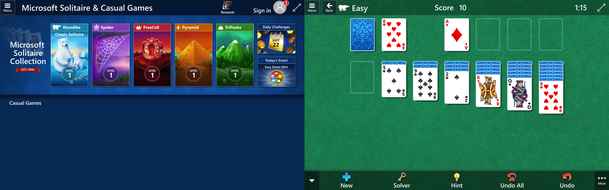
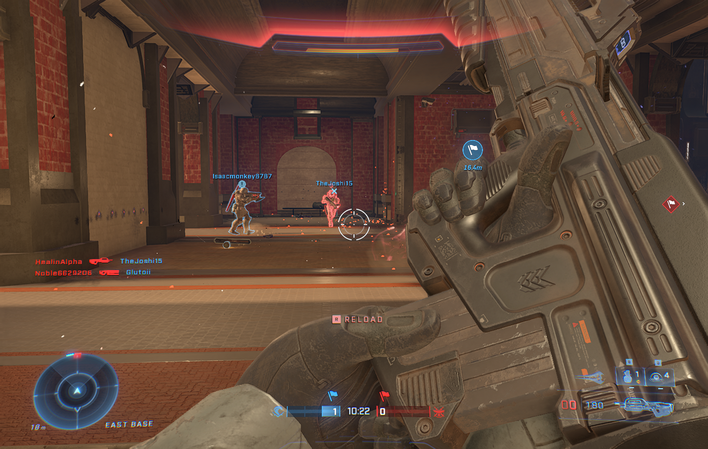

<h1 align="center">wine-uwp</h1>

<p align="center">
  A patched Wine that runs packaged Windows Store (UWP) apps on Linux.
</p>

<p align="center">
  
</p>

Stock Wine runs classic Win32 programs. Apps from the Microsoft Store are different: they come as signed
`.msix` packages, start through the Windows app model, draw their UI with XAML through DirectComposition,
and lean on hundreds of Windows Runtime classes. wine-uwp fills those gaps, well enough that real,
closed-source Store apps install and run, with no source and no symbols for any of them.

> **Looking to run Shapr3D?** Use **[Shapr3D for Linux](https://github.com/designgears/shapr3d-linux)**:
> one AppImage with a setup that does everything below for you.

## What runs

| App | State |
| --- | --- |
| **Shapr3D** | The target. Sketching, modelling, menus, cloud sync, sign-in, STL and PDF export |
| Microsoft Solitaire Collection | Playable: menus, games, card moves |
| Media Player | Plays audio from its own UI |
| Calculator | Fully working; the pixel-exact regression baseline |
| Feedback Hub | Works, interactive |
| Camera | Starts, then shows its own error page |
| Halo Infinite (GDK, via the Xbox app) | Installs from the Xbox app; campaign and online multiplayer play, with EasyAntiCheat |

<p align="center">
  
</p>

<p align="center">
  
</p>

## How it works

- **Wine, extended.** Our changes to Wine live in full in [`wine/`](wine/): about 49,000 lines over 196 files,
  on top of Wine 11.20. The largest pieces are new: a DirectComposition implementation
  (`dlls/dcomp`), composition swap chains (`dlls/dxgi`), and `wineuwp`, which hosts a package's app model:
  identity, activation, the CoreWindow, protocol activation.
- **Microsoft's own frameworks, not reimplementations.** XAML, CoreMessaging and the app-model DLLs are taken
  from an official Windows 11 image and run unmodified. wine-uwp makes Wine behave the way they expect.
- **Small stand-ins** ([`shims/`](shims/)) for Windows services that do not exist outside Windows (the Store,
  the token broker, the taskbar), answering the way the apps need.
- **Nothing of Microsoft's in the repository.** The Windows components are extracted on the user's machine from
  Microsoft's free Windows 11 evaluation ISO ([`packaging/harvest`](packaging/harvest)), and the app comes from
  the user's own package. A commit hook refuses Windows binaries.

## Using it

The runtime installs and runs any `.msix`/`.msixbundle` from the command line:

```sh
packaging/build-dist.sh ~/wine-uwp            # Wine, the scripts and shims (needs a build; see below)
~/wine-uwp/bin/wine-uwp harvest Windows11.iso # or fetch one: packaging/harvest/download_iso.py OUT.iso
~/wine-uwp/bin/wine-uwp new-prefix
~/wine-uwp/bin/wine-uwp install App.msixbundle
~/wine-uwp/bin/wine-uwp install-store 9PCDNBHR11MR  # or a Store app by Store id: signs in, downloads, and opens an encrypted (EAppx) package with your licence
~/wine-uwp/bin/wine-uwp run
```

Data lives in `$WINE_UWP_DATA`, by default `~/.local/share/wine-uwp`. See
[`packaging/README.md`](packaging/README.md) for the details.

## Building

1. **Wine.** Unpack the [Wine 11.20](https://dl.winehq.org/wine/source/11.x/wine-11.20.tar.xz) source, copy
   `wine/` over it (whole files, not patches; leave out its `FILES` and `BASE.txt`), then `autoreconf -f`, `./configure --enable-archs=x86_64`
   and `make`. Point `WINE_BIN_DIR` at the build directory.
2. **Shims.** `./build.sh` builds them with clang-cl and lld-link against the Windows SDK headers from
   [xwin](https://github.com/Jake-Shadle/xwin) in `~/xwin`.
3. **Runtime.** `packaging/build-dist.sh OUT`, then the steps under *Using it*.

The development setup (paths, prefixes, test apps) is in `env.sh`. Enable the commit hook once per clone:
`git config core.hooksPath githooks`.

## For contributors

This project is mostly investigation: finding out what a closed-source app expects and making Wine provide it.

- **[AGENTS.md](AGENTS.md)** is the working guide: how to investigate, the tools, and the mistakes that have
  already cost time.
- **[docs/Plan.md](docs/Plan.md)** describes the architecture, and **`docs/Findings-M*.md`** is the full log,
  including the approaches that did not work.
- `./regress.sh` is the regression suite (Calculator must stay pixel-identical, and several apps must come up),
  run on a private Xvfb display.
- The repository's many `*.py` tools read PE files, PDB symbols, WinRT metadata and registry hives;
  AGENTS.md has the table.
